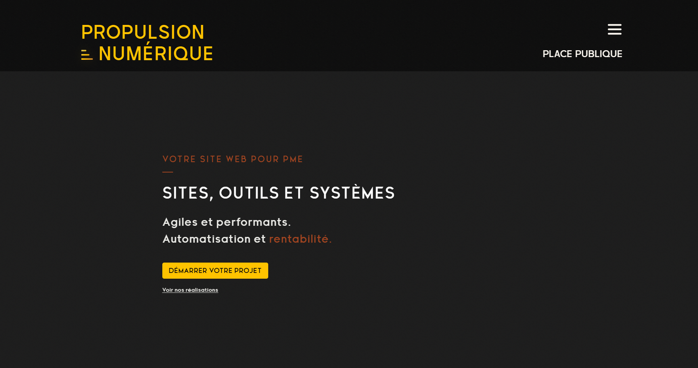

# 👋 Salut, je suis Jean-François Duval

**Développeur full stack TypeScript · IA et agents de programmation**  
Québec (QC) · [Portfolio](https://jeffduval1.github.io/portfolio/) · [Montages vidéo récents (16:9 et 9:16)](https://1drv.ms/f/c/5f18c55ff03c8e9d/IgB4XdKOYRT3R7EL2zRr6CiNAWuEsrrYtdZXUw7FrZQ0P9o?e=lAoPhI) · [LinkedIn](https://www.linkedin.com/in/jean-francois-duval-web)

En parallèle de mon poste au gouvernement du Québec (MELCCFP, après le MAMH), je conçois, développe et exploite plusieurs produits complets en production (plus de **4 200 commits** sur mes dépôts privés de production) en dirigeant plusieurs agents de programmation en parallèle (Claude Code, Cursor, OpenAI Codex, Google Gemini) encadrés par **33 protocoles écrits**.

---

## 🛠️ Stack et compétences en production

- **Interface et hors ligne :** TypeScript, React 18, Vite, TanStack Router et Query, CSS Modules, SCSS, HTML5, CSS3 (BEM, Flexbox, Grid), JavaScript modulaire, PWA installable avec service worker, dnd-kit, Quill, design réactif dès 320 px, accessibilité WCAG.
- **Serveur et données :** Node.js, Fastify 5, Zod 4, Drizzle ORM, PostgreSQL sur Supabase (région Montréal), migrations additives et rétrocompatibles, WordPress sur mesure (ACF Pro), PHP, TYPO3.
- **Modèles et API d'IA en production :** SDK Anthropic (Claude Sonnet 4.6, Haiku 4.5), SDK OpenAI (GPT-4o-mini, Whisper), prompts versionnés et gelés, suivi des coûts en dollars.
- **Direction d'agents de programmation :** Claude Code et Cursor en plans principaux au quotidien ; OpenAI Codex et Google Gemini en plans Pro pour la contre-vérification et les revues croisées ; fichiers `CLAUDE.md` par projet, hooks de pré-validation, index des erreurs par symptôme et registre des sujets déjà tranchés.
- **Services et paiement :** Clerk, Stripe (abonnements à 5 paliers, achats à l'unité, webhooks signés), Microsoft Graph (OAuth Outlook), AWS SES v2 et S3, Postmark, Resend, Twilio, Web Push.
- **Qualité, hébergement et mesure :** Vitest, Testing Library, Playwright (E2E multi-appareils sur base Postgres jetable), GitHub Actions, Dependabot, Fly.io, Cloudflare Pages, WP Engine, Sentry, UptimeRobot, sauvegardes en 3 couches testées sur 93 tables, API GA4, Search Console, API Meta, Google Business Profile.

---

## 🚀 Produits et systèmes en production

### 01 · DonkeyNote : SaaS de gestion de missions (matrice Eisenhower)
- 🌐 **En production :** [https://donkeynote.app](https://donkeynote.app) *(1 491 commits · conçu, développé et exploité depuis septembre 2025, en ligne depuis août 2026)*
- 🎬 **Démonstration vidéo :** [Voir la capsule « La cote qui range » dans le dossier OneDrive](https://1drv.ms/f/c/5f18c55ff03c8e9d/IgB4XdKOYRT3R7EL2zRr6CiNAWuEsrrYtdZXUw7FrZQ0P9o?e=lAoPhI)

- **Classificateur IA :** chaque note est classée dans la bonne catégorie par l'IA, avec file de revue et acceptation automatique au-delà de 0,92 de confiance.
- **Dictée Whisper :** transcription vocale dans les notes et les missions, vendue par forfait de 60 minutes à l'unité par Stripe.
- **Synchronisation Outlook :** OAuth Microsoft Graph, rendez-vous et séries sur le même jour civil des deux côtés, détection des doublons.
- **Rappels sans doublons :** courriel (AWS SES), notification push et SMS avec réservation en base avant le départ.
- **Abonnements et droits :** Stripe à 5 paliers d'accès, webhooks signés, droits vérifiés côté serveur.
- **Hors ligne et bilingue FR/EN :** PWA installable avec service worker, quatre filets contre l'écran blanc après mise à jour, corbeille et import/export en 3 stratégies avec copie de sécurité.
- **Tests et résilience :** près de 2 000 tests unitaires et serveur (Vitest, Testing Library) et environ 300 tests E2E Playwright sur base Postgres jetable ; revue de résilience de novembre 2026 (13 réparations en ligne), collecteur quotidien de 31 mesures, sauvegardes en 3 couches testées sur 93 tables.

---

### 02 · Propulsion Numérique : mon agence web et ses moteurs logiciels
- 🌐 **En production :** [https://propulsion-numerique.ca](https://propulsion-numerique.ca) *(2 028 commits)*
- 🧭 **Boussole entrepreneuriale :** [https://propulsion-numerique.ca/bilan-web-gratuit/](https://propulsion-numerique.ca/bilan-web-gratuit/)

- **Boussole entrepreneuriale (en ligne) :** questionnaire de qualification de 33 questions qui bifurque selon qu'on a un site ou non, lecture personnalisée générée par l'IA (prompt v1.41 versionné et gelé) et point d'abandon mesuré question par question dans GA4.
- **Moteur éditorial 2.0 (en préparation · sortie prochaine) :** l'outil qui écrit les articles d'une entreprise dans sa propre voix (plus de 200 décisions de conception consignées avant d'écrire le code, voix décortiquée sur bancs d'essai).
- **Moteur social :** extension WordPress avec façade en React 18, TypeScript et Vite (calendrier de publications, récurrences à paliers progressifs, suivi des publicités, multi-entreprises, installation chez un tiers par simple `.zip`).
- **Moteur de soumissions et surcouche courriel :** pipeline de 9 étapes (normalisation, assainissement, validation, jeton JS, piège à robots, limite de débit, idempotence, enregistrement, envoi Postmark avec webhooks).
- **Portail statistiques :** 7 sources interrogées par API (base de données du site, Postmark, GA4, Search Console, Meta, Google Business Profile, WP Engine), historique CSV cumulatif avec rattrapage de 30 jours et bilan écrit envoyé par courriel tous les 3 jours.

---

### 03 · Certi-Pro : site sur mesure et outils IA d'un garage automobile (client réel)
- 🌐 **En production :** [https://certi-pro.ca](https://certi-pro.ca) *(721 commits · en production depuis août 2026, sous contrat d'entretien)*

- **Moteur de calendrier d'entretien par IA (actif) :** le client entre son véhicule ; Claude Sonnet cherche en ligne le calendrier réel du constructeur, le code calcule la priorité (jamais l'IA), et Claude Haiku rédige avec sources et niveau de confiance obligatoires. Tâches asynchrones et coût d'usage suivi en dollars.
- **7 formulaires métier :** étapes multiples, validation conditionnelle (NIV obligatoire selon le service) et liens profonds préremplis.
- **Protocole d'entretien par IA :** entretien mensuel en 6 phases et 52 points de contrôle avec collecte automatique, preuves obligatoires et contre-vérification par un second agent.
- **Moteur de blog assisté par IA :** 6 patrons de contenu, accroches générées par l'IA, suggestions de maillage interne, 3 mises en page et 8 commandes en ligne de commande pour le traitement par lots.

---

### 04 · Ma façon de travailler et motion design par code
- 🎬 **Montages vidéo récents (16:9 et 9:16) :** [Ouvrir le dossier OneDrive partagé](https://1drv.ms/f/c/5f18c55ff03c8e9d/IgB4XdKOYRT3R7EL2zRr6CiNAWuEsrrYtdZXUw7FrZQ0P9o?e=lAoPhI)
- **33 protocoles écrits :** chacun avec sa phrase de déclenchement (commits, erreurs, révision par tours, rangement, rappels, navigateur, tests, entretien, lancement).
- **Chaîne de montage vidéo maison :** aucune caméra ; captures pilotées par Playwright, mouvement calculé au chiffre près, courbes et durées mesurées, recomposition 16:9 et 9:16, trames sonores SUNO.

---

### 05 · Autres projets de l'écosystème Donkey
- **Donkey Study :** tableau de bord d'études pour le cégep et l'université (notes de cours, cartes d'étude, rappels de révision jusqu'à l'examen, PWA bilingue, pipeline d'entrées durci avec Zod, piège à robots et limite de débit).
- **Donkey Life :** application mobile de cheminement personnel (les sphères de sa vie et une découverte de soi par la philosophie).

---

## 📫 Me contacter

- 🌐 **Portfolio :** [https://jeffduval1.github.io/portfolio/](https://jeffduval1.github.io/portfolio/)
- 📄 **CV en ligne :** [https://jeffduval1.github.io/cv-jf-duval/](https://jeffduval1.github.io/cv-jf-duval/)
- 🎬 **Montages vidéo récents :** [Dossier OneDrive (16:9 et 9:16)](https://1drv.ms/f/c/5f18c55ff03c8e9d/IgB4XdKOYRT3R7EL2zRr6CiNAWuEsrrYtdZXUw7FrZQ0P9o?e=lAoPhI)
- 💼 **LinkedIn :** [https://www.linkedin.com/in/jean-francois-duval-web](https://www.linkedin.com/in/jean-francois-duval-web)
- ✉️ **Courriel :** [jfduval.web@outlook.com](mailto:jfduval.web@outlook.com)
- 📞 **Téléphone :** 418 554-5828
