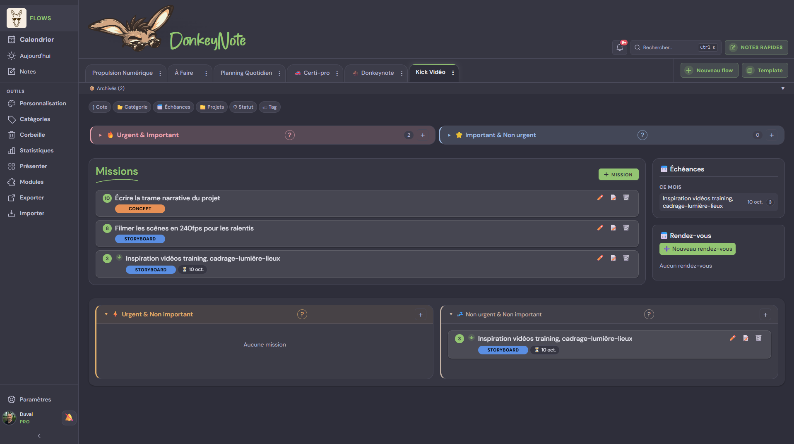
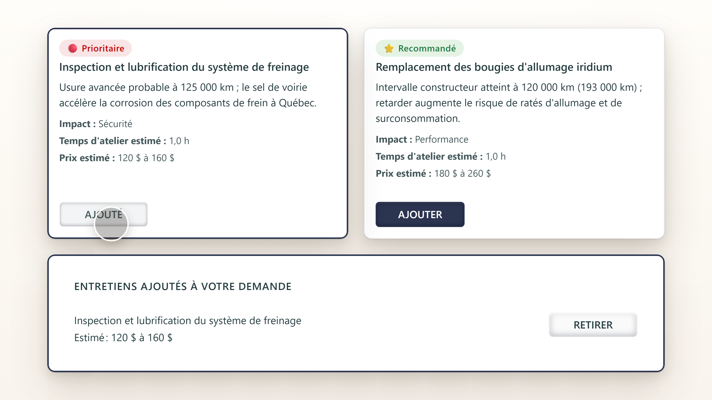

# 👋 Salut, je suis Jean-François Duval

**Développeur full stack TypeScript · IA et agents de programmation**  
Québec (QC) · [Portfolio](https://jeffduval1.github.io/portfolio/) · [CV en ligne](https://jeffduval1.github.io/portfolio/cv.html) · [Montages vidéo récents (16:9 et 9:16)](https://1drv.ms/f/c/5f18c55ff03c8e9d/IgB4XdKOYRT3R7EL2zRr6CiNAWuEsrrYtdZXUw7FrZQ0P9o?e=lAoPhI) · [LinkedIn](https://www.linkedin.com/in/jean-francois-duval-web)

En parallèle de mon poste au gouvernement du Québec (MELCCFP, après le MAMH), je conçois, développe et exploite plusieurs produits complets en production (plus de **4 200 commits** sur mes dépôts privés de production) en dirigeant plusieurs agents de programmation en parallèle (Claude Code, Cursor, OpenAI Codex, Google Gemini) encadrés par **33 protocoles écrits**.

---

## 🛠️ Stack et compétences en production

- **Interface et hors ligne :** TypeScript, React 18, Vite, TanStack Router et Query, CSS Modules, SCSS, HTML5, CSS3 (BEM, Flexbox, Grid), JavaScript modulaire, PWA installable avec service worker, dnd-kit, Quill, design réactif dès 320 px, accessibilité WCAG.
- **Serveur et données :** Node.js, Fastify 5, Zod 4, Drizzle ORM, PostgreSQL sur Supabase (région Montréal), migrations additives et rétrocompatibles, WordPress sur mesure (ACF Pro), PHP, TYPO3.
- **Modèles et API d'IA en production :** SDK Anthropic (Claude Sonnet 4.6, Haiku 4.5), SDK OpenAI (GPT-4o-mini, Whisper), prompts versionnés et gelés, suivi des coûts en dollars.
- **Direction d'agents de programmation (3 à 7 fils en parallèle) :** plan Max avec Claude, plans équivalents avec Cursor et Google Gemini, et plan Pro avec OpenAI Codex ; utilisation intensive de plusieurs agents à la fois avec contre-vérification et revues croisées ; fichiers `CLAUDE.md` par projet, hooks de pré-validation, index des erreurs par symptôme et registre des sujets déjà tranchés.
- **Services et paiement :** Clerk, Stripe (abonnements à 5 paliers, achats à l'unité, webhooks signés), Microsoft Graph (OAuth Outlook), AWS SES v2 et S3, Postmark, Resend, Twilio, Web Push.
- **Qualité, hébergement et mesure :** Vitest, Testing Library, Playwright (E2E multi-appareils sur base Postgres jetable), GitHub Actions, Dependabot, Fly.io, Cloudflare Pages, WP Engine, Sentry, UptimeRobot, sauvegardes en 3 couches testées sur 93 tables, API GA4, Search Console, API Meta, Google Business Profile.

---

## 🚀 Produits et systèmes en production

### 01 · DonkeyNote : SaaS de gestion de missions (matrice Eisenhower)
- 🌐 **En production :** [https://donkeynote.app](https://donkeynote.app) *(1 491 commits · conçu, développé et exploité depuis septembre 2025, en ligne depuis août 2026)*
- 🎬 **Capsule vidéo (format 16:9 ou 9:16 adapté à votre écran) :** [Voir « La cote qui range »](https://jeffduval1.github.io/portfolio/?video=cote-qui-range)

- **1. Classificateur IA :** chaque note est classée dans la bonne catégorie par l'IA, avec file de revue, acceptation automatique au-delà de 0,92 de confiance et journaux d'observabilité en production.
- **2. Dictée Whisper :** transcription vocale dans les notes et les missions, vendue par forfait de 60 minutes à l'unité par Stripe.
- **3. Synchronisation Outlook :** OAuth Microsoft Graph, rendez-vous et séries sur le même jour civil des deux côtés, détection des doublons.
- **4. Rappels sans doublons :** courriel (AWS SES), notification push et SMS avec réservation en base avant le départ.
- **5. Corbeille, export et import :** corbeille des missions, des notes et des flows ; export complet et import en 3 stratégies (recréer, fusionner, remplacer) avec copie de sécurité.
- **6. Abonnements et droits :** Stripe à 5 paliers d'accès, webhooks signés, droits vérifiés côté serveur.
- **7. Hors ligne :** PWA installable avec service worker, quatre filets contre l'écran blanc après mise à jour et test hors ligne sur le build de production.
- **8. Bilingue FR/EN :** toute l'interface en deux langues, avec passe de contre-vérification par groupes de 20 clés.
- **9. Tests :** près de 2 000 tests unitaires et serveur (Vitest, Testing Library) et environ 300 tests E2E Playwright sur base Postgres jetable.
- **10. Résilience et surveillance :** revue de novembre 2026 (13 réparations en ligne, garde sur la limite de débit Fastify), collecteur quotidien de 31 mesures et routine Claude quotidienne.
- **11. Protection des données :** sauvegardes en 3 couches testées sur 93 tables et migrations additives rétrocompatibles.

---

### 02 · Propulsion Numérique : mon agence web et ses 7 moteurs et outils
- 🌐 **En production :** [https://propulsion-numerique.ca](https://propulsion-numerique.ca) *(2 028 commits)*
- 🧭 **Boussole entrepreneuriale :** [https://propulsion-numerique.ca/bilan-web-gratuit/](https://propulsion-numerique.ca/bilan-web-gratuit/)
- 🎬 **Capsules vidéo (format adapté à votre écran) :** [« Le test de la vue » (Boussole)](https://jeffduval1.github.io/portfolio/?video=test-de-la-vue) · [« Des formulaires pour tout »](https://jeffduval1.github.io/portfolio/?video=des-formulaires)

- **1. Boussole entrepreneuriale (en ligne) :** questionnaire de qualification de 33 questions qui bifurque selon qu'on a un site ou non, lecture personnalisée générée par l'IA (prompt v1.41 versionné et gelé) et point d'abandon mesuré question par question dans GA4.
- **2. Moteur éditorial 2.0 (en préparation · sortie prochaine) :** l'outil qui écrit les articles d'une entreprise dans sa propre voix (plus de 200 décisions de conception consignées avant d'écrire le code, voix décortiquée sur bancs d'essai).
- **3. Moteur social :** extension WordPress avec façade en React 18, TypeScript et Vite (calendrier de publications, récurrences à paliers progressifs, suivi des publicités, multi-entreprises, installation chez un tiers par simple `.zip`).
- **4. Moteur de soumissions et surcouche courriel :** pipeline de 9 étapes (normalisation, assainissement, validation, jeton JS, piège à robots, limite de débit, idempotence, enregistrement, envoi Postmark avec webhooks).
- **5. Portail statistiques :** 7 sources interrogées par API (base de données du site, Postmark, GA4, Search Console, Meta, Google Business Profile, WP Engine), historique CSV cumulatif avec rattrapage de 30 jours et bilan écrit envoyé par courriel tous les 3 jours.
- **6. Collecte Meta et GA4 par API :** API Meta par jeton (campagnes, audiences, résultats) et API GA4 par compte de service sur deux sites.
- **7. Catalogue de sections :** page privée qui rassemble toutes les sections du site, prêtes à réutiliser pour un nouveau client.

---

### 03 · Certi-Pro : site sur mesure et outils IA d'un garage automobile (client réel)
- 🌐 **En production :** [https://certi-pro.ca](https://certi-pro.ca) *(721 commits · en production depuis août 2026, sous contrat d'entretien)*
- 🎬 **Capsules vidéo (format adapté à votre écran) :** [« Rappel d'entretien »](https://jeffduval1.github.io/portfolio/?video=rappel-entretien) · [« Formulaire de prise de RDV »](https://jeffduval1.github.io/portfolio/?video=formulaire-rdv)

- **1. Moteur de calendrier d'entretien par IA (actif · intégré à l'étape 2 du formulaire de prise de rendez-vous) :** à l'étape 2 du formulaire de prise de rendez-vous, le client entre son véhicule ; Claude Sonnet cherche en ligne le calendrier réel du constructeur, le code calcule la priorité (jamais l'IA), et Claude Haiku rédige avec sources et niveau de confiance obligatoires. Tâches asynchrones et coût d'usage suivi en dollars.
- **2. 7 formulaires métier :** étapes multiples, validation conditionnelle (NIV obligatoire selon le service) et liens profonds préremplis.
- **3. Protocole d'entretien par IA :** entretien mensuel en 6 phases et 52 points de contrôle avec collecte automatique, preuves obligatoires et contre-vérification par un second agent.
- **4. Moteur de blog assisté par IA :** 6 patrons de contenu, accroches générées par l'IA, suggestions de maillage interne, 3 mises en page et 8 commandes en ligne de commande pour le traitement par lots.

---

### 04 · Ma façon de travailler et motion design par code
- 🎬 **Capsules directes (16:9 ou 9:16 selon votre écran) :** [La cote qui range](https://jeffduval1.github.io/portfolio/?video=cote-qui-range) · [Le test de la vue](https://jeffduval1.github.io/portfolio/?video=test-de-la-vue) · [Des formulaires pour tout](https://jeffduval1.github.io/portfolio/?video=des-formulaires) · [Formulaire RDV](https://jeffduval1.github.io/portfolio/?video=formulaire-rdv) · [Rappel d'entretien](https://jeffduval1.github.io/portfolio/?video=rappel-entretien)
- 📂 **Dossier complet OneDrive (10 fichiers 16:9 et 9:16) :** [Ouvrir le dossier OneDrive partagé](https://1drv.ms/f/c/5f18c55ff03c8e9d/IgB4XdKOYRT3R7EL2zRr6CiNAWuEsrrYtdZXUw7FrZQ0P9o?e=lAoPhI)
- **33 protocoles écrits :** chacun avec sa phrase de déclenchement (commits, erreurs, révision par tours, rangement, rappels, navigateur, tests, entretien, lancement).
- **Chaîne de montage vidéo maison :** aucune caméra ; captures pilotées par Playwright, mouvement calculé au chiffre près, courbes et durées mesurées, recomposition 16:9 et 9:16, trames sonores SUNO.

---

### 05 · Autres projets de l'écosystème Donkey
- **Donkey Study :** tableau de bord d'études pour le cégep et l'université (notes de cours, cartes d'étude, rappels de révision jusqu'à l'examen, PWA bilingue, pipeline d'entrées durci avec Zod, piège à robots et limite de débit).
- **Donkey Life :** application mobile de cheminement personnel (les sphères de sa vie et une découverte de soi par la philosophie).

---

## 📫 Me contacter

- 🌐 **Portfolio :** [https://jeffduval1.github.io/portfolio/](https://jeffduval1.github.io/portfolio/)
- 📄 **CV en ligne :** [https://jeffduval1.github.io/portfolio/cv.html](https://jeffduval1.github.io/portfolio/cv.html) · [Télécharger le PDF](https://jeffduval1.github.io/portfolio/documents/cv-jfduval.pdf)
- 🎬 **Montages vidéo récents :** [Dossier OneDrive (16:9 et 9:16)](https://1drv.ms/f/c/5f18c55ff03c8e9d/IgB4XdKOYRT3R7EL2zRr6CiNAWuEsrrYtdZXUw7FrZQ0P9o?e=lAoPhI)
- 💼 **LinkedIn :** [https://www.linkedin.com/in/jean-francois-duval-web](https://www.linkedin.com/in/jean-francois-duval-web)
- ✉️ **Courriel :** [jfduval.web@outlook.com](mailto:jfduval.web@outlook.com)
- 📞 **Téléphone :** 418 554-5828
